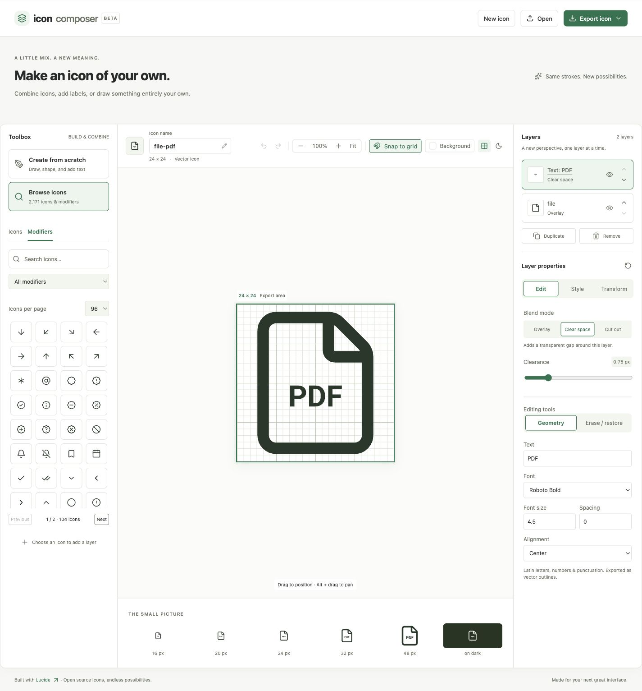
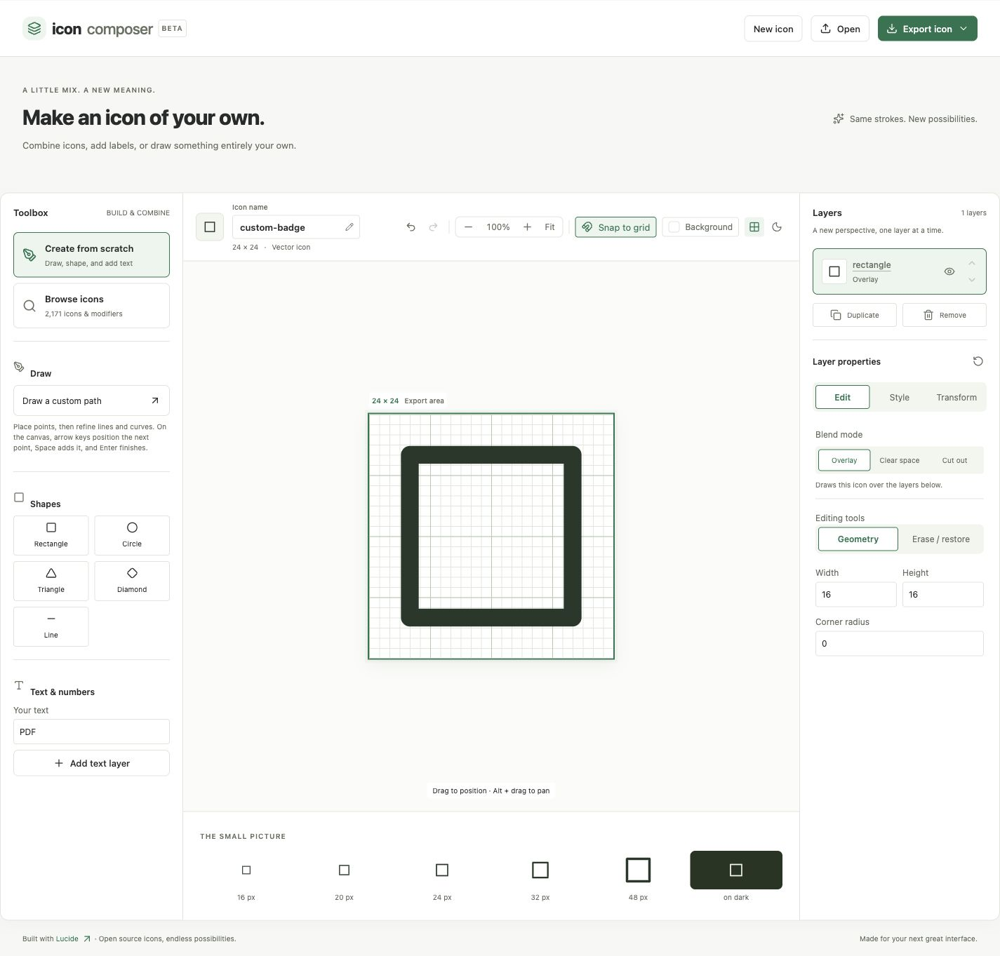
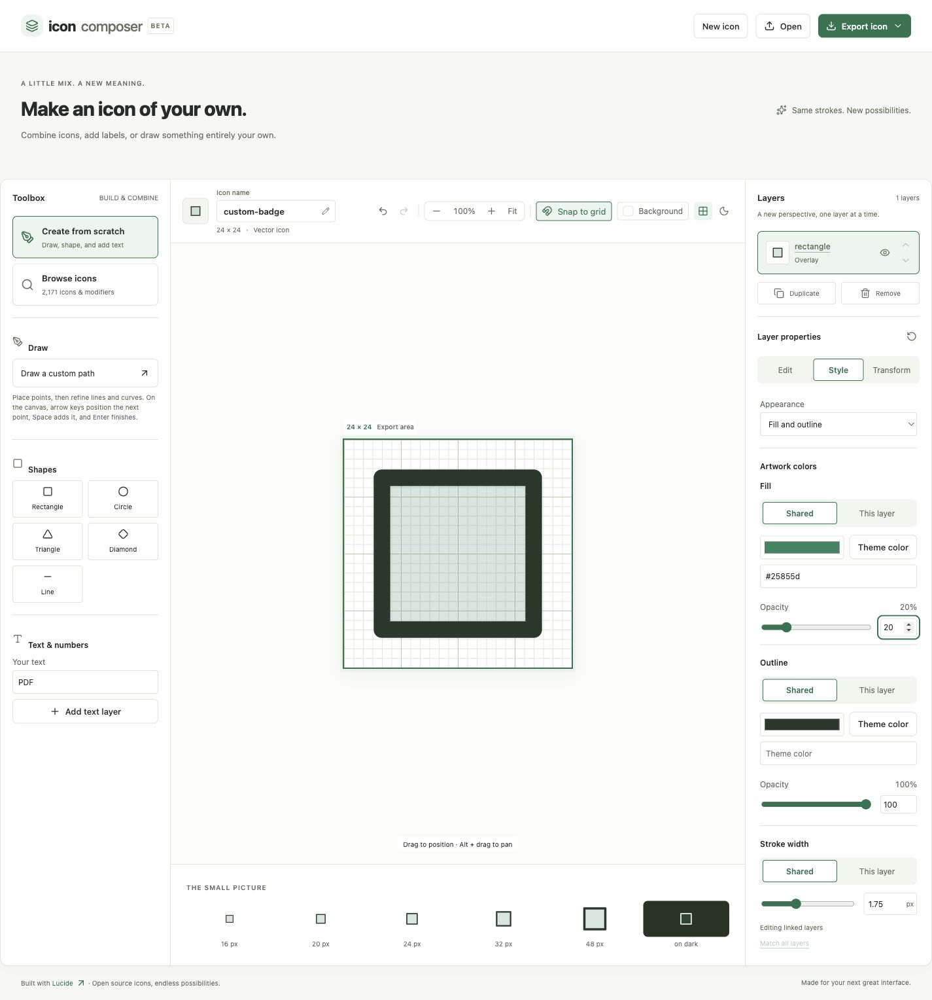

# Icon Composer: design-system integration handoff

Audience: the Vue design-system and application teams integrating the editor. Start here, then use [README](../README.md) for authoring behavior, [ACCESSIBILITY](../ACCESSIBILITY.md) for the review record, and [public types](../src/icon-composer.d.ts) for the full document schema.

## What is being handed over

Icon Composer is a Vue 3 editor delivered as the native `<icon-composer>` custom element. It uses open Shadow DOM and a self-contained ES module that bundles its own Vue runtime. It has no backend, authentication, network API, or required external font requests. The host owns asset storage, permissions, publishing, and navigation.

The editor supports Lucide icons, a curated modifier catalog, vector shapes, editable text outlines, custom paths, layer transforms, shared or per-layer colors and stroke widths, transparency, erasing/restoring, and SVG/Vue/PNG/JSON export. The native canvas/export coordinate system is always 24 × 24. Export size and zoom are separate concepts.



*The catalog, canvas, and inspector are independent areas. The Icons per page control offers 24, 48, or 96 results; the catalog scrolls inside its fixed-height grid.*

## Repository and build boundary

Everything belonging to this app is under `icon-composer/`. Other projects and reference material remain at the repository root.

```text
icon-composer/
  docs/INTEGRATION.md       This handoff
  docs/images/             App screenshots
  docs/examples/           Vue wrapper example
  src/element.ts           Custom-element registration and exports
  src/App.vue              Editor state and controls
  src/style.css            Shadow DOM layout consuming --ic-* tokens
  src/theme.css            Complete reference token map
  src/icon-composer.d.ts    Shipped public declarations
  src/types.ts             Source document types
  src/composition.mjs       Validation, rendering, and exports
  src/geometry.mjs          Shapes, path data, and text outlines
  src/vectors.mjs           Icon conversion and anchor editing
  src/erasing.mjs           Ordered erase/restore masks
  src/fonts.mjs             Generated bundled glyph outlines
  scripts/                 Build packaging and font generation
  tests/                   Unit tests and browser integration/audit fixtures
```

From the repository root:

```sh
cd icon-composer
npm ci
npm test
npm run build
npm run dev
```

Use a Node.js version supported by Vite 6 and your team's supported tooling baseline. This project does not currently pin a Node version. The dev server serves the app at `http://127.0.0.1:5173/`; run commands inside `icon-composer/`, not at the repository root.

The build outputs:

- `dist/index.html` and `dist/assets/`: standalone demonstration app.
- `dist/elements/icon-composer.js`: self-contained ES module, explicit registration.
- `dist/elements/icon-composer.d.ts`: public types beside the module.
- `dist/elements/theme.css`: optional reference theme.
- `dist/elements/THIRD_PARTY_NOTICES.md`: redistribution notices.

`dist/` and `node_modules/` are generated and ignored by Git. Build the artifact in your release pipeline. The project is currently private and has no published npm package, package exports map, or release automation. Vendor the built artifacts as described below, or add an internal packaging/release process before adopting package-manager imports.

## Recommended Vue integration

### 1. Vendor the built component

Copy **all four files** from `dist/elements/` into the consuming Vue app's `src/vendor/icon-composer/`. This gives the host bundler local module and type resolution. Do not copy the standalone `main.ts`, `demo.css`, or demo HTML into the design system.

Register the custom element once per browser page. Registration is idempotent for the same tag. For an SSR application, dynamically import and register it only on the client; render the editor after registration. The wrapper below does that.

### 2. Configure the Vue compiler

Add this predicate to the consuming application's existing Vue plugin configuration. If it already recognizes design-system custom elements, preserve that logic and extend it.

```ts
// Consumer vite.config.ts
vue({
  template: {
    compilerOptions: {
      isCustomElement: tag => tag === 'icon-composer'
      // Or: existingPredicate(tag) || tag === 'icon-composer'
    }
  }
})
```

Configure this in the app that compiles the template containing the custom-element tag. Vue does not infer this from the element's registration.

### 3. Add the host wrapper

Copy [IconComposerField.vue](examples/IconComposerField.vue) to the consuming app's `src/components/`. Its relative import expects the vendor directory from step 1. It provides `v-model`, export/error events, and client-only registration. It deliberately leaves storage and automatic downloads under host control.

```vue
<IconComposerField
  v-model="draft"
  @export="queueAssetForReview"
  @error="showError"
/>
```

`draft` is a `Composition | undefined`; `undefined` starts the editor with its built-in sample composition. If the product requires a blank document, pass a valid version-1 composition with `layers: []`. Persist editable JSON as the source of truth; save exported SVG/Vue/PNG as derived assets. The sample export handler is an integration point, not an implemented upload service.

### 4. Wire persistence and publishing

The component emits document snapshots and export payloads; it does not publish assets. Debounce host saves as appropriate, associate documents with asset IDs, show host save/error state, and run your existing review/publish process. Do not upload every emitted snapshot without considering request volume: changes can fire during pointer gestures and slider input.

Assign `composition` as a JavaScript **property** (`:composition.prop`), not a JSON HTML attribute. Input is validated and cloned. The component does not mutate the host object. A genuinely different externally supplied document resets the editor's undo/redo history; echoing an identical emitted snapshot back into the property is supported. Avoid normalizing each snapshot into different content while a user is editing, because that becomes an external replacement.

## Element API

Properties and matching attributes:

- `composition?: Composition`: JS property only; `{ version: 1, name, stroke, layers, palette? }`. See the declarations for optional text/shape/path/vector, color, and erasure fields.
- `storageKey?: string` / `storage-key`: opt-in browser localStorage. Supply before mounting. Omit when host persistence is authoritative. Use unique, appropriately scoped keys for independent documents; localStorage is not shared server storage.
- `downloads: boolean = false`: exports always emit; enabling this additionally triggers a browser download. In Vue bind booleans as properties. `downloads="false"` is a present boolean attribute and must not be used to disable downloads.
- `chrome: boolean = false`: enables the standalone introduction and footer. The editor header and its New/Open/Export controls remain present when false; replace the brand and add host controls through slots.

Listen **directly on the element**. Vue custom-element events put positional arguments in an array: the payload is `event.detail[0]`, not `event.detail`.

- `composition-change`: `CustomEvent<[Composition]>`; a detached document snapshot.
- `icon-export`: `CustomEvent<[IconExport]>`; `{ format, filename, blob, content? }`, where format is `svg | vue | png | json`. PNG supplies a Blob; other formats also supply string content. The handler can inspect/upload the Blob using the host's approved asset workflow.
- `composer-error`: `CustomEvent<[{ message: string }]>`; invalid incoming compositions and PNG export failures. Invalid incoming documents preserve the current editor state. JSON file-open failures and other authoring validation also appear as inline editor notifications; this event is not a universal notification feed.

No built-in `v-model`, autosave-to-server event, reset method, or publish method is exposed. Use the wrapper's model binding and the composition property. Keep Vue's event-array contract in any framework adapter.

## Theme and design-system controls

Import the supplied `theme.css` as a complete baseline, then override its `--ic-*` properties with your system tokens. Alternatively provide **every** token in [src/theme.css](../src/theme.css). Loading only a handful of color variables without a baseline leaves layout and sizing tokens unresolved.

```css
/* Consumer CSS; load after the reference theme. These --ds-* names are examples. */
icon-composer {
  --ic-font-family: var(--ds-font-body);
  --ic-heading-font-family: var(--ds-font-heading);
  --ic-text: var(--ds-text-primary);
  --ic-muted: var(--ds-text-secondary);
  --ic-background: var(--ds-background);
  --ic-surface: var(--ds-surface);
  --ic-surface-subtle: var(--ds-surface-subtle);
  --ic-border: var(--ds-border-subtle);
  --ic-control-border: var(--ds-border-control);
  --ic-accent: var(--ds-action-primary);
  --ic-accent-hover: var(--ds-action-primary-hover);
  --ic-accent-subtle: var(--ds-selection-background);
  --ic-on-accent: var(--ds-text-on-action);
  --ic-icon-color: var(--ds-text-primary);
  --ic-focus-color: var(--ds-focus-ring);
  --ic-radius-md: var(--ds-radius-control);
  --ic-control-height: var(--ds-control-height);
}
```

Map the remaining typography, spacing, sizes, focus, inverse-preview, grid, opacity, layering, and shadow tokens as needed. Keep text at AA contrast, control boundaries at 3:1 where required, and target sizes at least 24 CSS pixels. Re-run checks after changing tokens. The internal CSS contains structural layout rules and SVG geometry; host selectors such as `button { ... }` do not cross Shadow DOM.

The canvas's **dark preview** switch changes the artwork preview, not the whole editor theme. Apply your host dark-theme token mapping to the element for full UI dark mode. The Background control stores separate light/dark preview colors when storage is enabled. These view preferences live under `${storageKey}:view`; editable artwork uses `storageKey`. Preview backgrounds never become export backgrounds. Zoom, pan, and catalog page size are not part of the saved composition.



*Create from scratch starts a blank document. Shapes, text, path points, and numeric editing controls support custom artwork and alternatives to dragging.*



*Style controls distinguish Shared from This layer for colors and stroke width. These artwork values are separate from the host's UI theme.*

### Slots and CSS parts

Use `brand` to replace the default brand and `toolbar` for additional host controls. Slotted content keeps its host styles and can contain your existing design-system components.

```html
<icon-composer>
  <span slot="brand">Design system · Icon library</span>
  <ds-button slot="toolbar">Save draft</ds-button>
</icon-composer>
```

Slots do not replace every internal native button/input. If the design system mandates its own controls inside the editor, that is additional source work in `App.vue`. The existing integration surface is CSS tokens, slots, and parts.

Exposed parts include `root`, `header`, `button`, `open-button`, `export-button`, `export-menu`, `intro`, `workspace`, `library`, `create-panel`, `stage`, `canvas-toolbar`, `canvas`, `artboard`, `composition`, `background-controls`, `previews`, `name-field`, `inspector`, `layer`, `property-tabs`, `property-body`, `text-controls`, `shape-controls`, `path-controls`, `eraser-controls`, `color-controls`, `stroke-controls`, `footer`, and `toast`.

```css
icon-composer::part(header) { padding-inline: var(--ds-space-4); }
icon-composer::part(workspace) { box-shadow: none; }
```

Custom tag names are supported by `registerIconComposer('ds-icon-composer')`. Update the host compiler predicate, selectors, and typing accordingly. Add `class="icon-composer-theme"` for the reference theme to match a custom tag. Avoid deep Shadow DOM selectors as an integration API.

## Layout, exports, and operating limits

Give the element the full width of its editor region. Container queries adapt at 64rem and 36rem. The page handles vertical growth in creation/layer/inspector content; only catalog grids scroll internally. Choosing 96 results does not increase the catalog's height. Do not wrap the editor in a fixed-height container that clips its controls or focus rings.

SVG and Vue exports preserve groups and masks rather than flattening geometry into boolean paths. PNG is 512 × 512 and transparent. Theme-inherited `currentColor` remains in SVG/Vue; explicit artwork colors travel with the icon. PNG resolves inherited color using the editor's `--ic-icon-color` or inherited text color at export time. Review dark-preview artwork with the actual exported asset when these colors differ.

Generated Vue icons require Vue 3.5+ (`useId`) and accept `size`, `color`, `strokeWidth`, and `title`. Meaningful icons should receive a title; otherwise generated components are hidden from assistive technology. Per-layer explicit stroke/color values can take precedence over global export props.

Only the bundled Lucide catalog is integrated. Material Symbols or another set needs a source/provider integration, licensing review, and geometry/filled-icon validation; there is no public runtime icon-provider prop today. Arbitrary SVG upload, boolean path operations, collaborative editing, and server persistence are outside this handoff. The full catalog and font outlines make the built module large; load the editor on demand and measure its cost in the host app.

Composition import is bounded and validated (including layer count, known icons, colors, geometry, and eraser edits). Continue using your application's usual asset validation and trust boundaries when saving or rendering derived files. Include [THIRD_PARTY_NOTICES](../THIRD_PARTY_NOTICES.md) when distributing artifacts; the bundle includes Lucide and Roboto/Roboto Mono glyph data.

## Team acceptance checks

1. Run `npm test` and `npm run build` from `icon-composer/`.
2. On the dev server open `/tests/embedding.html` after building. Exercise two independently themed editors, host composition replacement, invalid input, controlled feedback, and all export events. Verify that editing one does not change the other and host keyboard input remains unaffected.
3. Open `/tests/accessibility.html` and activate Run accessibility checks at desktop and narrow widths. Review incomplete results as well as reported violations. Read [ACCESSIBILITY](../ACCESSIBILITY.md) for the current test scope and remaining screen-reader/browser validation; this is not a certification of full WCAG conformance.
4. In the real Vue shell, check property binding, event payload arrays, client registration, route unmount/remount, persistence boundaries, and artifact upload/review behavior.
5. Test your mapped light/dark themes, 200%/400% browser zoom, text spacing, visible/unobscured focus, keyboard drawing/erasing, catalog scrolling, VoiceOver/Safari and NVDA with a supported browser.
6. Verify SVG, Vue, PNG, and editable JSON round trips, masks, inherited colors, unique IDs with multiple exported Vue icons, and meaningful/decorative icon labeling in downstream applications.

Before release, the design-system team owns theme approval and component packaging; the consuming application team owns document persistence and publishing; accessibility reviewers validate the integrated host workflows. No deployment or backend change is included in this repository handoff.
